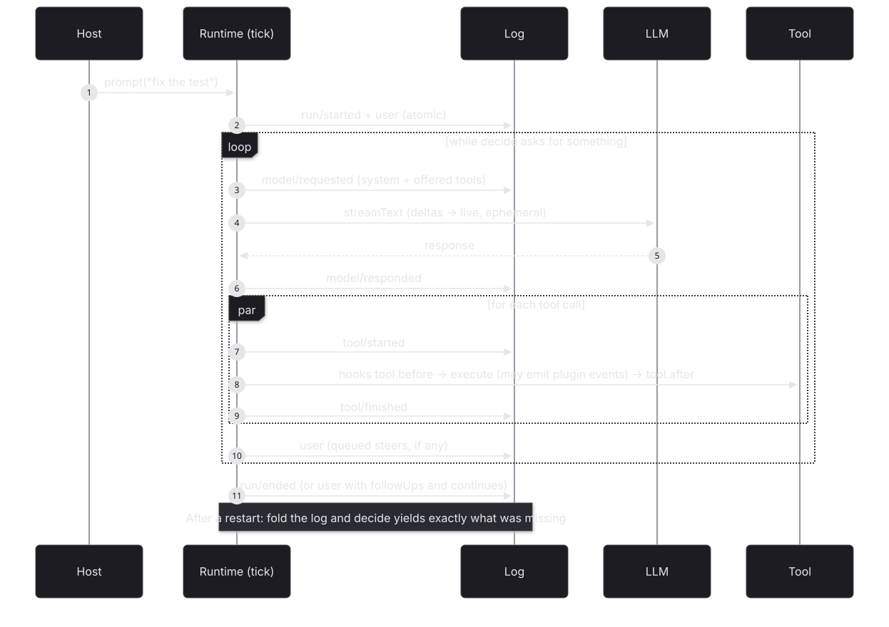
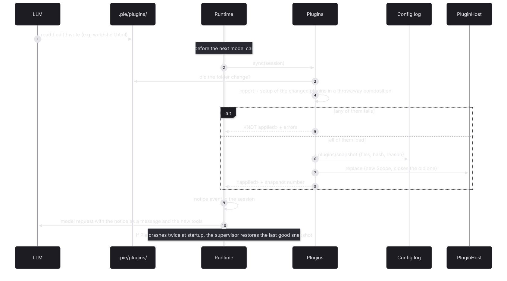

# Architecture

What is durable is always events (the session log); what is live is effects
derived from them. If something can be an extension, it is
an extension. Details in [EVENTS.md](EVENTS.md).

## 1 · Core and extensions



## 2 · The tick

The agent is an Elm program: `evolve(state, event)` and `decide(state, now)` are
pure. The runtime folds the branch, asks `decide` what is missing and executes
it; the results come back to the log as events. Resuming after a restart is the
same as any other tick.



## 3 · A prompt from start to finish



`model/requested` stores the system prompt and the offered tools: what the model
sees is in the log. Event ids are deterministic (run, turn, call), so repeating a
step never duplicates anything.

## 4 · A program that changes itself

Pie does not reload anything in place: extensions are code of the program that
embeds Pie. To change, the program restarts, which is safe at any moment because
runs resume from the log. A program can let its agent do it:



## 5 · What is persisted



| Table | What it stores |
|---|---|
| `pie_events` | The whole session, as a tree: core and extension events |
| `pie_sessions` | cwd, initial model and leaf of the current branch |
| `pie_cursors` | How far each reaction has processed in each session |
| `pie_workflow` | Journal of the Effect workflows: executions, activities, deferreds, clocks, results |
| `pie_attachments` | Files attached to messages: hash, type, size and the name of the file in `attachments/` next to the database (the events reference the hash) |
| `pie_meta` | Which process opened the database last (the write that takes the exclusive lock) |

Streaming deltas are never stored: they go through `session.live`. Extension
projections are not stored either: they are recomputed by folding the branch.

## 6 · States of a run



## 7 · Environments



## 8 · Edge cases

| Case | What happens | Status |
|---|---|---|
| SIGKILL with a model turn already answered | The model is not called again. | tested |
| SIGKILL during an idempotent tool | It is repeated. | tested |
| SIGKILL during a non-idempotent tool | It is not repeated: "outcome unknown". | tested |
| SIGKILL in the middle of the model stream | `model/requested` without a response: the call is repeated. | implemented |
| Provider failure | `model/failed` with a retry time; 3 attempts with backoff; then `failed`. | tested |
| prompt with an active run / steer / followUp | SessionBusy; steer after the tools; followUp at the end, in the same run. | tested |
| abort during a tool | The tool is cut off, the run ends `aborted`, the session is free. | tested |
| Tool ids repeated across turns | Event ids include the turn. | tested |
| Parallel extension tools that read state | Events record facts; ids and counters are derived by the projection. | tested |
| Forking (navigate) with extension state | The projection is that of the branch. | tested |
| Restart in the middle of a run (a program that changes itself) | The run resumes in the new process, on the new code. | tested (examples/app) |
| An extension that fails to load | The boot fails with the extension's error. | implemented |
| Effect workflow with SIGKILL | Completed activities are not repeated; the clock keeps its time; the approval resumes it; the result is stored. | tested |
| Two processes on the same database | SQLite exclusive mode: the second one fails at startup with `StorageLocked`; a killed process releases the file at once. | tested |
| New reaction on existing sessions | It starts from now, not from the history. | implemented |
| Very long sessions | Projections fold the whole branch on every read; snapshots will be needed. | pending |
| Forking a session with running workflows | The workflow journal is not part of the session tree. | risk |
| Changing core event types or payloads | They are the durable contract: compatible changes only. | risk |

## 9 · SDK API

```ts
import { NodeRuntime } from "@effect/platform-node"
import { Effect, Stream } from "effect"
import { Pie, Storage } from "pie-agent"
import { defaults, todo } from "@pie-agent/plugins"

const PieLive = Pie.layer({
  storage: Storage.sqlite("pie.db"),   // durable; one process per file
  plugins: [...defaults, todo]         // the extensions, in order
})

const program = Effect.gen(function*() {
  const pie = yield* Pie.Pie
  const session = yield* pie.create({ cwd: "/repo", model: "opencode-go/deepseek-v4.1-flash" })
  yield* session.live.pipe(Stream.runForEach((event) => Effect.log(event.type)), Effect.forkScoped)
  yield* session.prompt("fix the test")
  const outcome = yield* session.awaitIdle   // completed | failed | aborted
  const events = yield* session.events       // the current branch: the whole truth
  const tasks = yield* session.projection("todo")
  yield* session.navigate(events[1]!.id)     // the next prompt branches from there
})

NodeRuntime.runMain(program.pipe(Effect.provide(PieLive), Effect.scoped))
```

More in [SDK.md](SDK.md). Writing extensions: [PLUGINS.md](PLUGINS.md).
